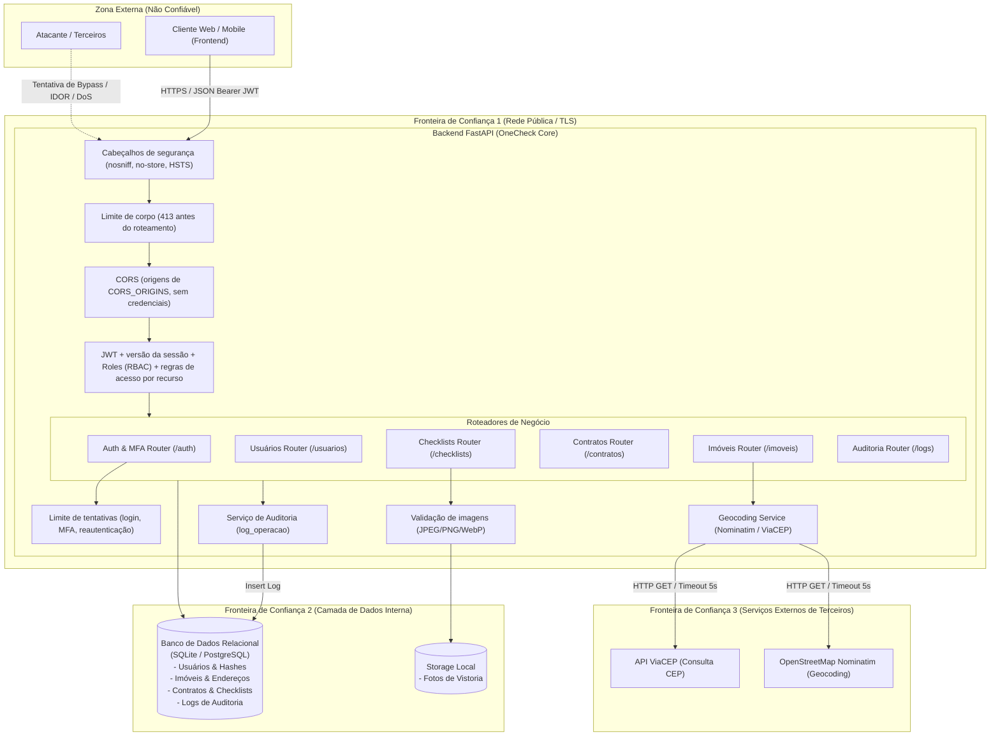

# Arquitetura do Sistema e Fronteiras de Confiança (v1)

_Última atualização: 2026-10-26, depois das correções de segurança SEC-001 a SEC-009 e SEC-016. Os detalhes de cada controle e os riscos ainda abertos estão em [`docs/security/`](../security/threat-model.md)._

## 1. Contexto e Domínio do Sistema

O **OneCheck** é uma plataforma de gestão de vistorias e locações imobiliárias projetada para imobiliárias, administradores, vistoriadores e locatários. A API RESTful centraliza o controle de acesso, cadastro de propriedades com geolocalização automática, emissão e assinatura de laudos periciais de vistoria de entrada e saída, além de auditoria das operações.

### Perfis de Acesso (RBAC)
- **Administrador (`admin`):** Acesso irrestrito a configurações, usuários, auditoria e operações do sistema. Único perfil que atribui ou gerencia `admin` e `gestor`. Exige MFA obrigatório.
- **Gestor (`gestor`):** Gestão operacional de imóveis, vistorias, contratos e dos usuários `vistoriador`, `locatario` e `visualizador`. Exige MFA obrigatório.
- **Vistoriador (`vistoriador`):** Preenchimento técnico das vistorias atribuídas a ele. Lê só os contratos e imóveis dessas vistorias. Não aprova a própria vistoria. Exige MFA obrigatório.
- **Locatário (`locatario`):** Visualização dos próprios contratos e imóveis, aceite ou contestação de laudos e abertura de problemas.
- **Visualizador (`visualizador`):** Leitura de imóveis, contratos e vistorias, sem acesso a problemas e usuários.

---

## 2. Diagrama de Arquitetura e Fronteiras de Confiança

---

## 3. Fronteiras de Confiança (Trust Boundaries)

| Fronteira | Descrição | Nível de Risco | Controles Implementados |
|---|---|---|---|
| **FC-01: Internet ➔ Backend** | Ponto de entrada de requisições públicas de navegadores, apps e atacantes. | **Alto** | - TLS/HTTPS terminado no proxy do Render; HSTS fora de desenvolvimento. - CORS restrito às origens de `CORS_ORIGINS`, sem credenciais. - Limite de tamanho do corpo antes do roteamento (`413`). - Validação estrita de schema e tipos com Pydantic. - Autenticação JWT (HS256, PyJWT) com access token de 60 min e refresh token rotativo de 30 dias. - Fluxo de MFA (TOTP) obrigatório para `admin`, `gestor` e `vistoriador`, com setup bloqueante no login. - Limite de tentativas falhas por conta e por IP (`429` com `Retry-After`). - Documentação interativa (`/docs`, `/openapi.json`) desligada em produção. |
| **FC-02: Backend ➔ Banco de Dados / Storage** | Acesso às tabelas relacionais, credenciais protegidas e arquivos de mídia. | **Crítico** | - ORM SQLAlchemy com consultas parametrizadas (proteção contra SQL Injection). - Senhas hasheadas via Bcrypt com salt aleatório. - Segredo MFA novo fica pendente (`mfa_secret_pendente`) até um código válido confirmar. - Uploads só JPEG, PNG e WebP, validados pelo conteúdo, com nome aleatório e servidos com `nosniff` e CSP `sandbox`. - Soft delete com flag `ativo` impedindo perda acidental de dados. - Tabela de auditoria `log_operacao` gravada a cada escrita. |
| **FC-03: Backend ➔ APIs Externas (ViaCEP / Nominatim)** | Saída de requisições do backend para serviços de terceiros para enriquecimento de endereço. | **Médio** | - Requisições com timeout curto e explícito (5 segundos). - Tratamento de exceções com fallback gracioso (Fail-safe: não quebra a requisição caso a API externa esteja fora). - User-Agent customizado e sanitização rigorosa de parâmetros de busca. |

**Limitações conhecidas** (detalhes no [modelo de ameaças](../security/threat-model.md)):
- O CPF fica em texto no banco e volta em toda resposta de usuário (SEC-014). O segredo TOTP também fica em texto no banco.
- O log de auditoria não registra o IP nem os campos alterados (SEC-010).
- As fotos em `/uploads` são públicas para quem tem a URL (T-14).

---

## 4. Controles Arquiteturais Chave

1. **Autenticação e Gestão de Sessões:**
   - Senhas protegidas com `bcrypt` (fator de custo padrão da biblioteca).
   - JWT emitido com `sub`, `role`, `type`, `ver` e `exp`. `exp`, `sub` e `type` são obrigatórios na leitura, e o algoritmo é fixo em HS256.
   - Tipos de token separados: `access`, `mfa` (login com MFA) e `mfa_setup` (primeiro acesso); um não vale no lugar do outro.
   - `ver` é a versão de sessão da conta (`usuarios.token_version`). Trocar senha, autenticador, perfil ou MFA, ou desativar a conta, incrementa a versão e apaga os refresh tokens, o que encerra todas as sessões. Quem troca a própria credencial recebe um par novo na resposta.
   - Refresh tokens opacos armazenados em banco como hash SHA-256 e revogados após rotação ou logout.
   - `JWT_SECRET` obrigatório (32+ caracteres) fora de desenvolvimento.
2. **Autorização Granular (RBAC + ABAC/Contextual):**
   - Dependência `require_roles("admin", ...)` para autorização por papel.
   - Regras de acesso por recurso em `app/deps.py`, as mesmas na listagem e no acesso por ID:
     - `assert_acesso_contrato` e `assert_acesso_imovel`: o locatário acessa o que é dele; o vistoriador, o que tem vistoria atribuída a ele;
     - `assert_acesso_problemas`: admin, gestor ou o locatário do contrato.
   - Separação de deveres: só admin/gestor criam vistorias, e quem vistoriou não aceita nem rejeita.
3. **Validação de Entrada e Imutabilidade de Estado:**
   - Schemas Pydantic tipados com restrições de tamanho, regex e enums válidos.
   - Máquina de estados para checklists e contratos (ex.: laudo finalizado ou imóvel locado com restrição de exclusão).
4. **Trilha de Auditoria e Não-Repúdio:**
   - Cada mutação de estado registra autor, ação, entidade e ID da entidade no banco, com o payload sanitizado (senhas e segredos ocultados).
   - Logins falhos, falhas de MFA e rotação de credenciais também são registrados.
5. **Cadeia de Suprimentos:**
   - `requirements.lock` com versão exata e hash de todas as dependências; o Render, o Docker e o CI instalam com `--require-hashes`.
   - O CI roda o `pip-audit` sobre o lockfile e falha quando há vulnerabilidade conhecida.
   - As actions do CI são fixadas por SHA, e o `GITHUB_TOKEN` só tem `contents: read`.
6. **Execução (container):**
   - Imagem sem compilador, com pacotes instalados só a partir de wheels (`--only-binary`).
   - A API roda como usuário sem privilégio (`app`); o código é só leitura e apenas `uploads/` é gravável.
   - Nenhum banco de dados é versionado no repositório.
