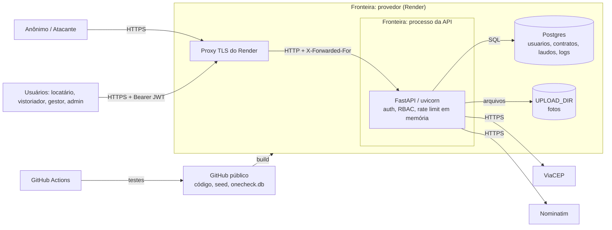

# Modelo de Ameaças — OneCheck API

_Última atualização: 2026-10-25 (auditoria sobre `f081c60`; SEC-001 a SEC-007 corrigidos em seguida, ver correções [001–003](correcao-sec-001-002-003-2026-10-25.md), [004–005](correcao-sec-004-005-2026-10-25.md) e [006–007](correcao-sec-006-007-2026-10-25.md))_

## 1. Visão geral
API REST (FastAPI + SQLAlchemy) para vistorias de locação: cadastro de imóveis e contratos, checklists de vistoria com fotos, aceite pelo locatário, registro e acompanhamento de problemas e geração de PDF do laudo.
- **Clientes:** front web e mobile.
- **Deploy:** Render (plano free: 1 instância, Postgres gerenciado, TLS terminado no proxy) e Docker Compose local.
- **Repositório:** **público** no GitHub.

## 2. Ativos
| Ativo | Tipo | Pilar mais crítico | Onde fica |
|---|---|---|---|
| Credenciais (hash bcrypt, segredo TOTP, refresh tokens) | Dado | Autenticidade | `usuarios`, `auth_refresh_tokens` |
| `JWT_SECRET` e `SEED_SECRET` | Chave | Confidencialidade | variáveis de ambiente (Render / `.env`) |
| Dados pessoais (nome, e-mail, CPF) | Dado | Confidencialidade (LGPD) | `usuarios` |
| Endereços de imóveis e coordenadas | Dado | Confidencialidade | `enderecos` |
| Contratos (valor, locatário, datas) | Dado | Integridade | `contratos` |
| Laudos, fotos e aceites | Evidência | Integridade, Não-repúdio | `checklists`, `checklist_itens`, `aceite_checklists`, `UPLOAD_DIR` |
| Trilha de auditoria | Dado | Não-repúdio | `log_operacao` |
| Disponibilidade da API | Serviço | Disponibilidade | processo uvicorn (1 worker) |

## 3. Atores
| Ator | Confiança | Acesso |
|---|---|---|
| Anônimo / atacante externo | Nenhuma | `/auth/login`, `/auth/mfa/*` com temp token, `/health`, `/uploads/{arquivo}`, `/docs` (só com `DOCS_ENABLED`), `/admin/*` (com `SEED_SECRET`) |
| Locatário | Baixa | os próprios contratos, problemas, aceites; uploads de foto de problema |
| Visualizador | Baixa | leitura de checklists e PDFs (global, por decisão a confirmar) |
| Vistoriador | Média | checklists atribuídos (escrita), leitura de contratos/imóveis vinculados |
| Gestor | Alta | gestão de imóveis, contratos, usuários não privilegiados, logs |
| Administrador | Total | tudo, inclusive contas admin/gestor e `/admin/*` |
| Mantenedor / CI | Alta | repositório, GitHub Actions, painel do Render |
| Serviços externos | Baixa | ViaCEP e Nominatim (respostas consumidas pela API) |

## 4. Diagrama de fluxo de dados

## 5. Fronteiras de confiança
| Fronteira | Fluxos que cruzam | Controles |
|---|---|---|
| Internet ↔ API | todas as rotas | TLS no proxy; JWT HS256 com `type` verificado (`app/deps.py:19`); RBAC `require_roles`; rate limit de auth (`app/rate_limit.py`); validação de upload (`app/uploads.py`); limite de corpo antes do roteamento (`app/limite_corpo.py`); CORS só para as origens configuradas, sem credenciais, e cabeçalhos de segurança (`app/main.py`, `app/cabecalhos.py`) |
| API ↔ Banco | ORM SQLAlchemy | consultas parametrizadas; DDL estático (`app/database.py`). **Falta:** credencial dedicada de menor privilégio |
| API ↔ Disco (uploads) | gravação e download de fotos | nome aleatório, assinatura conferida antes do Pillow, parser restrito a JPEG/PNG/WebP, `caminho_seguro`, `nosniff` + CSP. **Falta:** autenticação no download |
| API ↔ serviços externos | CEP e geocoding | URL fixa HTTPS, CEP só com dígitos, timeout 5 s |
| Repositório público ↔ deploy | build e start | seed automático só em desenvolvimento; fora dele, credenciais aleatórias (SEC-001). **Falta:** rotacionar contas antigas em produção; banco versionado (SEC-009) |
| Container ↔ host | execução | **Falta:** usuário não root (SEC-008) |

## 6. Ameaças (STRIDE por elemento)
| ID | Elemento | STRIDE | Ameaça | Pilar | Mitigação existente | Status | Achado |
|---|---|---|---|---|---|---|---|
| T-01 | Login | S | Entrar como admin com as credenciais públicas do seed | Autenticidade | seed sem credenciais fixas fora de dev; alerta e script de rotação para contas antigas (`app/seed_service.py`) | Mitigada no código (rotação em produção pendente) | SEC-001 |
| T-02 | Login / MFA | S | Força bruta de senha e TOTP | Autenticidade | `Tentativas` por conta e IP (`auth_router.py:47-58`) | Mitigada (por processo) | — |
| T-03 | MFA | S | Login só com senha usando token de setup | Autenticidade | tipos `mfa` × `mfa_setup` (N1) | Mitigada | — |
| T-04 | JWT | S | Forjar token com segredo padrão | Autenticidade | `JWT_SECRET` obrigatório e forte fora de dev (`config.py`) | Mitigada | — |
| T-05 | Sessões | S | Token roubado continua válido após troca de senha/reset de MFA | Autenticidade | `token_version` nos JWT + refresh tokens apagados (`encerrar_sessoes`, `app/auth.py`) | Mitigada | SEC-005 |
| T-06 | Login | I | Enumerar e-mails pelo tempo de resposta | Confidencialidade | mensagem genérica | Parcial | SEC-013 |
| T-07 | Usuários | E | Gestor se promove ou gerencia admins | Autorização | `_assert_pode_gerenciar` / `_assert_pode_atribuir` (N4) | Mitigada | — |
| T-08 | Checklists | E/T | Locatário cria e aprova a própria vistoria | Integridade | criação só admin/gestor; separação de deveres (N3) | Mitigada | — |
| T-09 | Contratos / Imóveis | I | Vistoriador lê qualquer contrato/imóvel pelo ID | Confidencialidade | `assert_acesso_contrato` / `assert_acesso_imovel` (`app/deps.py`) | Mitigada (visualizador com leitura global, a decidir) | SEC-004 |
| T-10 | Problemas | I | BOLA por ID | Confidencialidade | `assert_acesso_problemas` (item 6) | Mitigada | — |
| T-11 | Usuários | I | Listagem de usuários com CPF para qualquer perfil | Confidencialidade | restrito a admin/gestor (item 2) | Parcial (CPF segue nas respostas) | SEC-014 |
| T-12 | Uploads | T/E | Arquivo malicioso explora o decoder de imagem | Integridade | Pillow 13; assinatura antes do parser; `formats` restrito; limite de pixels (`app/uploads.py`) | Mitigada | SEC-002 |
| T-13 | Uploads | T | XSS armazenado via HTML/SVG servido pela API | Integridade | validação de conteúdo + `nosniff` + CSP (N7) | Mitigada | — |
| T-14 | Uploads / download | I | Fotos de vistoria acessíveis sem login | Confidencialidade (LGPD) | nomes aleatórios de 128 bits | Aceita? (decisão pendente) | — |
| T-15 | API | D | Corpo multipart gigante processado antes da auth | Disponibilidade | `LimiteCorpoMiddleware`; formulário lido após a auth | Mitigada | SEC-003 |
| T-16 | API | D | Limite de tentativas usado para bloquear contas de terceiros | Disponibilidade | janela de 15 min | Aceita (custo do T-02) | — |
| T-17 | Problemas | T | Locatário abre problema já "fechado" | Integridade | status validado só contra a lista | **Aberta** | SEC-012 |
| T-18 | Auditoria | R | Ações sem IP e sem os campos alterados | Não-repúdio | `log_operacao` em todas as escritas | Parcial | SEC-010 |
| T-19 | MFA por admin | R | Admin define o TOTP de outro usuário e age em nome dele | Não-repúdio | reset separado do setup (parcial) | **Aberta** | SEC-015 |
| T-20 | Dependências | T/E | CVE em pacote (Pillow, python-multipart, python-jose) | Integridade | PyJWT no lugar do python-jose; `requirements.lock` com hashes, instalado com `--require-hashes`; `pip-audit` no CI | Mitigada | SEC-006 |
| T-21 | Repositório | I | Banco e seed publicados no GitHub | Confidencialidade | só dados de seed hoje | Parcial | SEC-001, SEC-009 |
| T-22 | Navegador | I | Site de terceiro lê respostas da API (CORS `*`) | Confidencialidade | auth por Bearer (sem cookie); CORS só para `CORS_ORIGINS`, sem credenciais; `/docs` desligado em produção; `no-store`, `nosniff`, HSTS | Mitigada (depende de `CORS_ORIGINS` no Render) | SEC-007 |
| T-23 | Container / CI | E | Código executado como root; action repontada | Integridade | — | **Aberta** | SEC-008 |

Status: **Mitigada** · **Parcial** · **Aberta** · **Aceita**

## 7. Riscos aceitos
_Seção mantida manualmente pela equipe — preservar entre execuções._
| ID | Risco | Justificativa | Responsável | Revisar em |
|---|---|---|---|---|

## 8. Premissas
- TLS é terminado pelo proxy do Render, e o banco gerenciado não fica exposto à internet.
- O deploy roda com **uma instância e um worker**; o limite de tentativas em memória depende disso.
- O proxy do Render sobrescreve o `X-Forwarded-For` (não verificado; se não sobrescrever, o limite por IP pode ser contornado).
- A autenticação do front é só por header Bearer; não há cookies de sessão.
- O perfil `visualizador` tem leitura global de checklists e PDFs por decisão de negócio (a confirmar).
